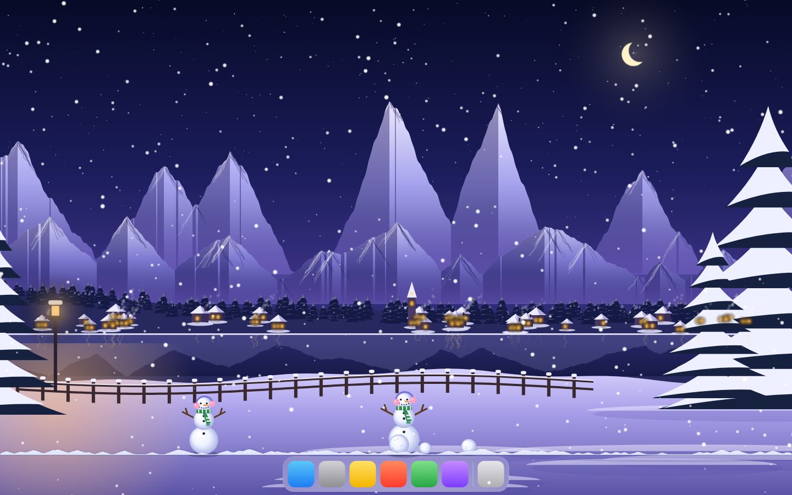
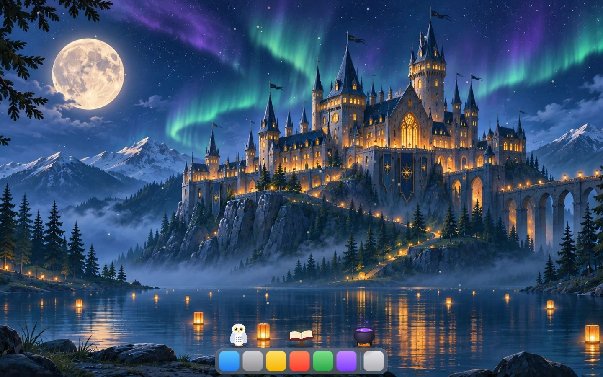
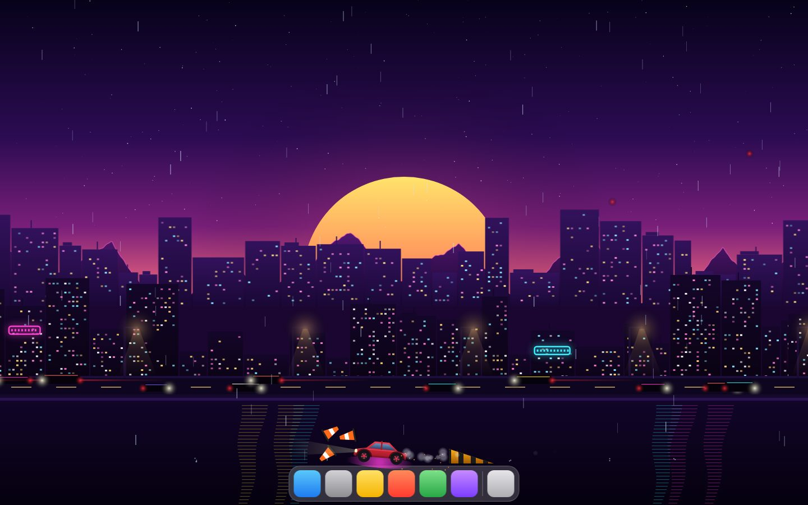
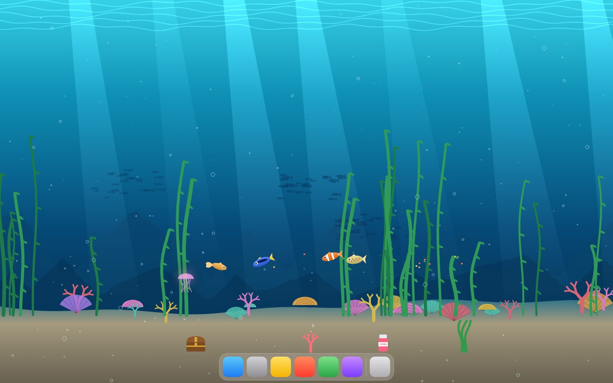

# Desk Diorama

Live, interactive wallpapers for macOS. Snowballs roll onto your Dock and stack into snowmen you can dress up. Snow falls over your screen and **piles up on top of your windows**. Your cursor blows it around, and shaking the cursor starts a blizzard. You can deck your desktop with lights and a tree, send Santa, a snowplough or a yeti, and switch to a wizard castle, a neon night drive or a coral reef.

**Price:** free to try, **$1 lifetime** for everything (Dodo Payments license key).

| Snowy Village (free) | Wizard Academy | Night Drive | Coral Reef |
| --- | --- | --- | --- |
|  |  |  |  |

## Features

**Themes:** each has an animated wallpaper behind your desktop icons plus toys that stand on the Dock.

- **Snowy Village:** moonlit village, snowfall, chimney smoke, shooting stars.
  - Snowballs drop onto the Dock. Drag one onto another to stack them; three make a snowman (if you leave them alone, they build one themselves).
  - Double-click a snowman for the *"Fashion week, but colder."* panel: hat, face, body and clothes, 32 items in all.
  - Santa flies by and drops gifts. Clicking a gift gives a snowman a new outfit.
  - **Send:** Santa, snowmen, a snowplough (clears the snow off the Dock and pushes snowballs) or a yeti (waves and stomps).
- **Wizard Academy:** castle on a cliff, floating candles, aurora and a broom rider. Your cursor leaves a wand trail. The mail owl brings letters with fortunes, the cauldron brews random spells, and the spellbook offers 8 spells, 8 wand trails, 8 owls and 8 potions.
- **Night Drive:** synthwave city scrolling past, traffic and neon. A car on the Dock honks, drives around and launches off a ramp (fast enough and it flips), and knocks over cones. The garage has 8 bodies, 8 paints, 6 wheels and 8 extras.
- **Coral Reef:** sun rays, swaying kelp, fish schools and a passing whale. Feed your fish (they race for the food and grow), open the treasure chest for new fish, add decor, and puff up the puffer.

**Weather** (works with every theme; menu bar → Weather, or the app's Weather page):

- Snow, rain, cherry blossoms, autumn leaves, hearts or confetti; or **Match the theme** / **Match the season**.
- Amount (light → blizzard), wind (calm, breeze ←/→, gusty), pause, **Clear Snow**.
- It **piles up on the Dock and on top of app windows**. Move a window and its snow slides off. Swipe the cursor fast along a ledge to brush it off.
- The cursor pushes flakes around. **Shake the cursor** for a blizzard.

**Deck your screen:** a tree, string lights (drag the ends to stretch), baubles, a star, wreath, stocking, candy cane, gifts, bells, gingerbread, holly, Santa hat, snow globe, cocoa and a snowman. They sit on the desktop **behind your windows**. Planting a tree turns the snow on.

**Free vs Pro ($1 lifetime)**

| Free | Pro |
| --- | --- |
| Snowy Village + half the snowman outfits | All themes and all outfits |
| Snow, any amount/wind, piles on windows | Rain, blossoms, leaves, hearts, confetti, season mode |
| Santa & snowmen | Snowplough & yeti |
| 6 decorations | All 17 decorations |
| Locked themes: 90-second preview | — |

Other details: menu-bar app (no Dock icon), multiple displays, pauses on battery and when the screen locks, 30/60 fps setting, open at login, <kbd>⌥⌘D</kbd> hides the toys, and all sound effects are synthesized in code (no audio files).

## Painted wallpapers

Each theme can show a painted illustration (like the reference videos) with live animation on top. The app finds the lit windows and lamps and makes them flicker, puts twinkling stars only in dark sky, and adds snowfall, sparkles, rain or bubbles. Put the images in `assets/wallpapers/` as `<theme>-<scene>.jpg`; prompts and rules are in **[docs/ART_PROMPTS.md](docs/ART_PROMPTS.md)**. Without an image, a theme uses its illustrated (code-drawn) version. Pro users can also pick **their own picture** and get the same animated treatment.

## Run it

```bash
npm install
```

```bash
npm start
```

Use `npm run dev` to open the app window on every launch.

**Browser preview** (no Electron needed): open `src/renderer/preview.html`, or run `npm run preview`. It shows a fake desktop with a Dock and a draggable window, plus controls for themes, weather, Send and Decorate.

## Build for release

**No Apple Developer account?** Push to GitHub and the **Build macOS app** workflow (`.github/workflows/build-mac.yml`) builds an ad-hoc-signed universal `.dmg` on a free Mac runner. Download it from the run's *Artifacts*, or push a tag like `v1.0.0` to attach it to a GitHub Release. Buyers approve it once in System Settings; see **[docs/INSTALL.md](docs/INSTALL.md)**.


On a Mac with Xcode Command Line Tools:

```bash
npm run dist:mac
```

This builds the `window-watcher` helper (so snow can land on windows) and then a universal `.dmg` + `.zip` in `dist/`.

To sign and notarize (strongly recommended, or macOS will warn "unidentified developer"), set these before building:

```bash
export CSC_NAME="Developer ID Application: Your Name (TEAMID)"
export APPLE_ID="you@example.com"
export APPLE_APP_SPECIFIC_PASSWORD="xxxx-xxxx-xxxx-xxxx"
export APPLE_TEAM_ID="TEAMID"
```

## Payments (Dodo Payments)

Step-by-step dashboard setup: **[docs/DODO_SETUP.md](docs/DODO_SETUP.md)**.


1. In the Dodo dashboard, create a **one-time product** priced at **$1** and turn on **License keys** for it. Set the activation limit to 2–3 devices.
2. Put the product ID in `src/main/config.js` (`PRODUCT_ID`), or build with `DD_DODO_PRODUCT_ID=pdt_xxx`.
3. Keep `MODE = 'test'` and buy with a test card to try the flow. Switch to `'live'` (or `DD_DODO_MODE=live`) for release.
4. Optionally set the product's return URL to `deskdiorama://purchased`, so the app reopens on the "paste your key" screen after checkout.

How it works: **Unlock** opens the Dodo checkout page in the browser. Dodo emails the buyer a license key, which they paste into the app. The app calls Dodo's public `/licenses/activate` endpoint, so **no API key ships inside the app**. It re-checks with `/licenses/validate` every few days, and network failures never lock a paying user out.

## Project layout

```
src/main/        main.js (windows, tray, IPC), license.js (Dodo), config.js, windows.js (window watcher)
src/renderer/    engine.js, layers.js, weather.js, decor.js, themes/*.js, app.* (settings/store window)
src/shared/      catalog.js (themes + weather list, used by both processes)
build/helper/    window-watcher.swift (reads window positions; no Screen Recording permission needed)
scripts/         build-helper.sh, make-assets.js (icons + thumbnails), serve-preview.js
```

How the layers work: one borderless **desktop-level window per display** draws the wallpaper and decorations (behind icons and windows). One **transparent, always-on-top, click-through window** on the main display draws the toys and weather. It only captures the mouse while the pointer is over a toy or panel, so clicks everywhere else go straight through to your apps.
